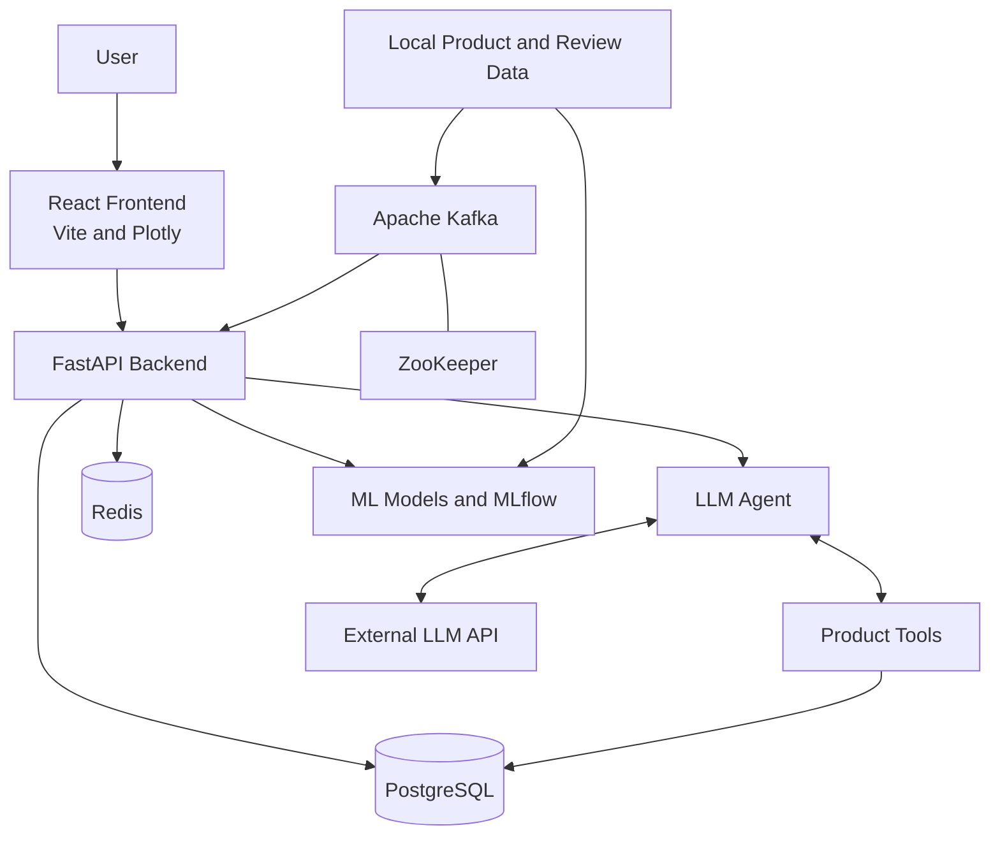
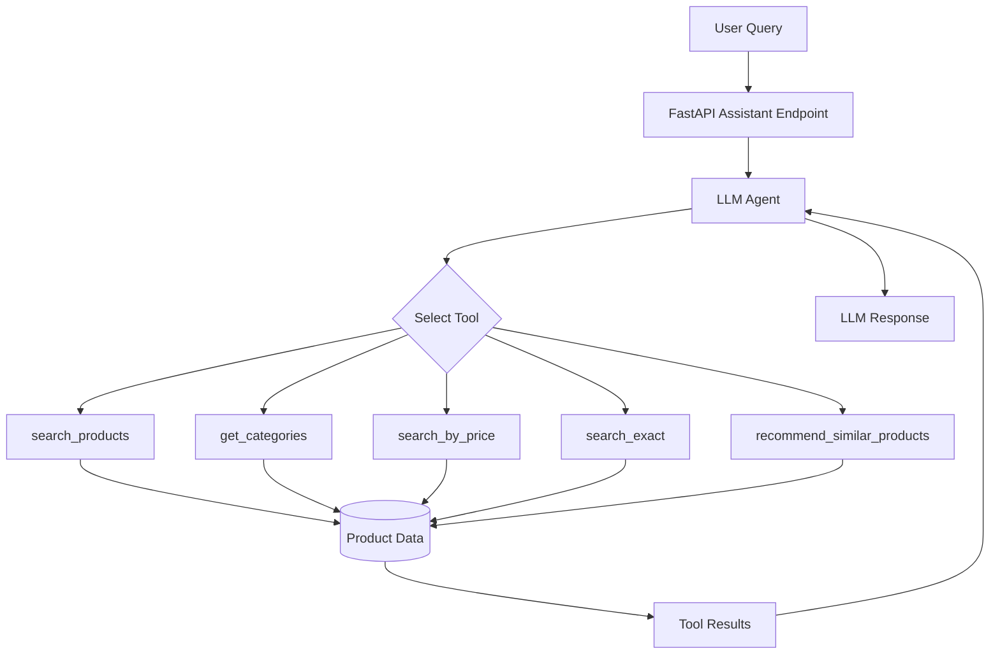

<div align="center">

# ProductIQ

### AI-Powered Product Intelligence Platform

**Product Analytics · Persian Review Intelligence · Explainable Recommendations · LLM Agent**

</div>

---

## Overview

ProductIQ is an AI-powered product intelligence platform designed to analyze product catalogs and customer reviews, discover product patterns, explore product clusters, and support product discovery and recommendation workflows.

The platform combines a React dashboard, a FastAPI backend, machine-learning components, structured data storage, streaming workflows, and an LLM-powered assistant that can use application tools to retrieve product information.

ProductIQ supports local development in WSL/Linux and a Docker Compose setup for running the configured application stack.

> **Project status:** The roadmap describes the planned scope of the project. It does not imply that all phases or features are complete. Feature availability depends on the current implementation, configuration, datasets, and model artifacts.

## Key Features

- **Product Analytics:** Explore product catalogs, categories, brands, prices, and ratings through interactive dashboards.
- **Persian Review Intelligence:** Analyze review sentiment at sentence level and derive review-level verdicts.
- **Product Clustering:** Explore groups of similar products and their profiles.
- **Explainable Recommendations:** Provide supporting information for recommendations where implemented.
- **LLM Agent:** Use an external LLM API with product-search and recommendation tools.
- **Streaming Workflows:** Support Kafka-based review and product processing where configured.
- **Model Tracking:** Integrate with MLflow for experiment and model-related workflows.
- **REST API:** Expose analytics, assistant, clustering, monitoring, evaluation, and model-management endpoints through FastAPI.

## Architecture



This diagram presents a high-level view of the platform. The actual request and processing paths depend on the implemented components and runtime configuration.

## Technology Stack

| Component | Technologies |
|---|---|
| Frontend | React, Vite, React Router, Axios |
| Visualization | Plotly, Recharts |
| Backend | Python, FastAPI, Uvicorn |
| Data Processing | Pandas, NumPy |
| Machine Learning | Scikit-learn and project-specific model components |
| Database | PostgreSQL, SQLAlchemy |
| Cache | Redis |
| Streaming | Apache Kafka, ZooKeeper |
| Experiment Tracking | MLflow |
| LLM Integration | External LLM API |
| Containerization | Docker, Docker Compose |
| Development | WSL/Linux, Python virtual environment, Node.js, npm |

## Dataset

ProductIQ uses the [Digikala Comments and Products Dataset on Kaggle](https://www.kaggle.com/datasets/radeai/digikala-comments-and-products) for product analytics and customer review intelligence.

Download the dataset and place the CSV files in the expected locations:

```text
data/
└── raw/
    ├── digikala-comments.csv
    └── digikala-products.csv
```

The datasets are not bundled with this repository. Keep large raw datasets and generated artifacts out of Git commits, and verify that the downloaded filenames and schemas match the application's data-loading code.

## LLM Agent and Tool Integration

ProductIQ integrates an external LLM API with application tools to support product discovery and recommendation workflows.

The agent can select a relevant tool, use the returned product information as context, and generate a natural-language response. Its usefulness depends on the available catalog data, tool implementation, and LLM configuration.

### Available Tools

| Tool | Description |
|---|---|
| `search_products` | Searches the product catalog using a user's query. |
| `get_categories` | Retrieves available product categories for category discovery. |
| `search_by_price` | Searches for products matching a specified price or price range. |
| `search_exact` | Searches for an exact product or specific product name. |
| `recommend_similar_products` | Retrieves similar product recommendations using the supported recommendation logic. |

### Agent Workflow



The diagram illustrates the tool-calling concept. It does not imply that every request invokes every tool; tool selection depends on the user's request and the application's routing logic.

## Repository Structure

```text
.
├── api/                  # FastAPI application and routes
├── config/               # Application configuration
├── data/                 # Local datasets and generated data
├── docker/               # Dockerfiles and related configuration
├── frontend/             # React and Vite application
├── models/               # Local model artifacts
├── scripts/              # Data and operational scripts
├── src/
│   ├── database/         # Database-related code
│   ├── kafka/            # Streaming producers and consumers
│   ├── models/           # Model implementation and inference
│   └── ...               # Other application modules
├── tests/                # Automated tests
├── mlruns/               # Local MLflow tracking artifacts
├── docker-compose.yml
├── requirements.txt
├── .env.example
└── README.md
```

Some directories and artifacts are generated locally and may not be tracked by Git.

## Prerequisites

### For both execution methods

- Ubuntu/WSL or another supported Linux environment.
- Access to the required datasets and model artifacts.
- A configured environment file containing the settings required by the selected services.

### For local execution without Docker

- Python 3.12 is used by the current backend Docker image.
- pip and the existing project virtual environment.
- Node.js and npm compatible with the frontend configuration.
- PostgreSQL, Redis, and Kafka with ZooKeeper when required by the selected features.
- Access to the configured external LLM API if LLM functionality is required.

### For Docker Compose

- Docker Engine.
- Docker Compose.
- Sufficient disk space for images, dependencies, datasets, and model artifacts.

## Configuration

Create the environment file from the provided template:

```bash
cp .env.example .env
```

If `.env` already exists, preserve it and edit it rather than overwriting it.

Configure the required values for your selected execution method.

| Variable | Purpose |
|---|---|
| `DB_HOST` | PostgreSQL hostname |
| `DB_PORT` | PostgreSQL port |
| `DB_USER` | Database username |
| `DB_PASSWORD` | Database password |
| `DB_NAME` | Database name |
| `REDIS_HOST` | Redis hostname |
| `REDIS_PORT` | Redis port |
| `KAFKA_BOOTSTRAP_SERVERS` | Kafka bootstrap address |
| `KAFKA_TOPIC` | Configured Kafka topic |
| `OPENAI_API_KEY` | API key for compatible LLM integrations |
| `LLM_API_KEY` | LLM provider API key |
| `LLM_BASE_URL` | LLM API endpoint |
| `LLM_MODEL` | LLM model identifier |
| `PORT` | Application port setting, where used |
| `DEBUG` | Application debug setting, where used |

Not every variable is necessarily consumed by every component. Follow the corresponding implementation and configuration when setting up an individual service.

**Security:** Never commit `.env` or real credentials to Git.

---

# Running ProductIQ

Choose one of the following approaches for your development or demonstration environment.

## Option 1 — Run Locally in WSL/Linux (Without Docker)

This method is intended for developers who want to run and debug application components directly.

### Step 1: Enter the project directory

```bash
cd ~/dgikala
```

Adjust the path if your repository is located elsewhere.

### Step 2: Activate the existing Python environment

```bash
source .venv/bin/activate
```

The project uses a single root `.venv`. If it is missing, establish the environment setup before proceeding rather than creating additional virtual environments unnecessarily.

Install the project dependencies when required:

```bash
python -m pip install -r requirements.txt
```

### Step 3: Configure environment variables

```bash
cp .env.example .env
```

If `.env` already exists, do not overwrite it.

Configure the database credentials, Redis and Kafka addresses, and any required LLM API settings.

For local execution, service hostnames must be reachable from the host environment. Docker service names such as `db`, `redis`, and `kafka` do not automatically resolve outside the Compose network.

### Step 4: Start PostgreSQL and Redis

Install and configure PostgreSQL and Redis using the supported package manager or existing installations for your Linux distribution.

On Ubuntu/WSL installations managed through `service`, the commands may be:

```bash
sudo service postgresql start
sudo service redis-server start
```

Verify Redis connectivity:

```bash
redis-cli ping
```

Expected output:

```text
PONG
```

Create or configure the PostgreSQL database and user using the values in `.env`. Use the project's existing database initialization code and migrations where available instead of assuming a database schema or running unverified scripts.

### Step 5: Start Kafka when required

The current Docker Compose configuration uses Kafka with ZooKeeper. For a non-Docker setup, Kafka and ZooKeeper must be installed and configured separately.

If the Kafka distribution archive is available locally, inspect its contents and configuration before using it. Start ZooKeeper and Kafka in separate terminal sessions according to the configuration of that distribution.

Verify that the application's bootstrap address and topic names match the running broker and the actual producer/consumer code.

For example, `localhost:9093` is the host-side Kafka port exposed by the current Compose configuration. A local Kafka installation may use a different port.

### Step 6: Start the backend

With the root virtual environment active and the required environment variables configured:

```bash
python -m uvicorn api.main:app --host 0.0.0.0 --port 8000
```

Open the interactive API documentation:

[http://localhost:8000/docs](http://localhost:8000/docs)

### Step 7: Start the frontend

Open a second terminal:

```bash
cd ~/dgikala/frontend
npm install
npm run dev
```

Vite normally serves the development frontend at:

[http://localhost:5173](http://localhost:5173)

Use the URL printed by Vite if another port is selected.

Ensure the frontend API configuration points to the running backend. The development frontend and production Nginx setup may use different API routing rules.

### Step 8: Validate the local environment

Confirm that:

- The backend API documentation loads.
- The frontend can reach its required backend endpoints.
- PostgreSQL and Redis are available for features that depend on them.
- Kafka is available if streaming features are being used.
- Required datasets and model artifacts exist.

A running frontend alone does not establish that every application feature is operational.

---

## Option 2 — Run with Docker Compose

Docker Compose provides an integrated way to start the application and its configured infrastructure.

### Step 1: Check Docker and Compose

```bash
docker --version
docker compose version
```

Install and configure Docker using the official instructions for your operating system if either command is unavailable.

### Step 2: Configure the environment

From the repository root:

```bash
cp .env.example .env
```

Preserve an existing `.env` file. Configure the required database credentials and any LLM API credentials needed for your use case.

### Step 3: Validate the Compose configuration

```bash
docker compose config --quiet
```

Resolve any reported configuration errors before starting the application.

### Step 4: Build and start the services

```bash
docker compose up --build -d
```

The current Compose configuration defines six services:

- PostgreSQL
- Redis
- Kafka
- ZooKeeper
- Backend
- Frontend

Kafka uses ZooKeeper in this Compose setup.

### Step 5: Inspect service status

```bash
docker compose ps
```

Inspect the backend logs if a service fails to start:

```bash
docker compose logs --tail=200 backend
```

Follow the backend logs continuously:

```bash
docker compose logs -f backend
```

Inspect other services as needed:

```bash
docker compose logs --tail=100 db
docker compose logs --tail=100 redis
docker compose logs --tail=100 kafka
```

### Step 6: Open the application

| Component | Local address |
|---|---|
| Frontend | [http://localhost](http://localhost) |
| Backend API | [http://localhost:8000](http://localhost:8000) |
| Interactive API documentation | [http://localhost:8000/docs](http://localhost:8000/docs) |
| Kafka host-side port | `localhost:9093` |

The Kafka port is a broker connection endpoint, not a web dashboard. The current Compose configuration does not define a Kafka UI service.

### Step 7: Stop the environment safely

Stop and remove the Compose containers and network:

```bash
docker compose down
```

Or stop services without removing their containers:

```bash
docker compose stop
```

Avoid `docker compose down -v` unless you explicitly intend to remove Compose-managed volumes. Host-mounted datasets and files must also be protected from accidental deletion.

## Local Development vs. Docker Compose

| Topic | Local WSL/Linux | Docker Compose |
|---|---|---|
| Backend | Run Uvicorn directly | Runs in the backend container |
| Frontend | Run the Vite development server | Served by the configured frontend container |
| PostgreSQL and Redis | Install and manage separately | Configured as Compose services |
| Kafka and ZooKeeper | Configure and manage separately | Configured as Compose services |
| Service addresses | Host-accessible addresses | Compose service names for internal communication |
| Debugging | Direct access to Python and Node.js processes | Inspect container status and logs |
| Best suited for | Development and debugging | Integrated demonstrations and repeatable local environments |

---

## API Overview

The backend provides endpoints for analytics, product assistance, clustering, monitoring, evaluation, and model management.

| Route | Purpose |
|---|---|
| `/api/analytics/summary` | Analytics summary |
| `/api/analytics/categories` | Category analytics |
| `/api/analytics/brands` | Brand analytics |
| `/api/analytics/price-distribution` | Price distribution |
| `/api/analytics/price-rating` | Price and rating analysis |
| `/api/analytics/satisfaction` | Satisfaction-related analytics |
| `/api/analytics/clustering-overview` | Clustering overview |
| `/api/analytics/nlp-overview` | NLP analytics overview |
| `/api/assistant/recommend` | Assistant and product recommendation workflow |
| `/api/clustering/profiles` | Cluster profiles |
| `/api/models/experiments` | MLflow experiment-related endpoints |
| `/api/models/versions` | Model version-related endpoint |
| `/api/models/monitoring` | Model monitoring endpoint |
| `/api/monitoring/stats` | Monitoring statistics |
| `/api/kafka_evaluation/status/{eval_id}` | Kafka evaluation status |

For the exact registered endpoints, request parameters, and response schemas, open the interactive API documentation at `/docs` in a running instance.

## Testing

The repository contains tests and test utilities for selected application components.

Activate the root virtual environment and install the required dependencies before running tests.

Inspect test collection:

```bash
python -m pytest --collect-only -q
```

Run the available test suite:

```bash
python -m pytest
```

Some tests may require environment variables, infrastructure services, datasets, or model artifacts. Configure those dependencies before running integration tests.

These commands describe how to execute tests; they do not imply that all tests currently pass.

## MLflow and Model Artifacts

The project includes MLflow-related components and a local `mlruns/` directory for experiment artifacts.

In the Docker configuration, the local `mlruns/` directory is mounted into the backend container. Experiment records and model artifacts depend on the environment and may not be included in a clean checkout.

Before running inference or evaluation workflows, confirm that the required model files exist and are compatible with the installed dependencies.

## Troubleshooting

### Backend fails to start

Inspect the backend logs:

```bash
docker compose logs --tail=200 backend
```

For local execution, review the terminal output and verify that the virtual environment is active and required environment variables are set.

### Database connection fails

Confirm that PostgreSQL is running, the database and user exist, and the configured host, port, username, password, and database name match the application's configuration.

Inside Compose, the database hostname is normally `db`. In local execution, use a hostname reachable from WSL/Linux.

### Redis connection fails

Check the Redis service status and run:

```bash
redis-cli ping
```

Inside Compose, the Redis service hostname is `redis`.

### Kafka connection fails

Confirm that Kafka and ZooKeeper are running and that the configured bootstrap address is reachable from the process making the connection.

- Inside Compose: `kafka:9092`
- From the host: `localhost:9093` in the current Compose configuration

Also verify the topic names used by the producer and consumer.

### Frontend cannot reach the backend

Confirm that the backend is running and that the frontend API base URL or proxy configuration matches the selected execution method. Host-side development requests and container-to-container requests may require different addresses.

### Missing dataset or model

Check the expected file paths and ensure that the required datasets and model artifacts are available locally. Large datasets and generated artifacts are not guaranteed to be present in a fresh checkout.

### Port conflict

Identify the process using the conflicting port and adjust the configuration deliberately. Ensure that frontend, backend, database, Redis, and Kafka addresses remain consistent after a port change.

## Security and Data Handling

- Keep `.env` out of version control.
- Never commit API keys, passwords, tokens, or private connection strings.
- Revoke or rotate credentials that have previously been committed or exposed.
- Review Git history and tracked data/model artifacts before making the repository public.
- Respect the dataset's applicable terms of use and any privacy or redistribution restrictions.
- Do not expose database or infrastructure ports publicly without an appropriate security configuration.
- Back up important datasets and model artifacts before cleanup or infrastructure changes.

## Roadmap

ProductIQ is organized around a 16-phase development roadmap:

1. Environment setup, data understanding, cleaning, and dashboard foundation.
2. Persian sentence-level sentiment analysis and review-level verdicts.
3. Feature engineering and PostgreSQL integration.
4. Product clustering.
5. Cluster profiling and explainability.
6. Embedding-based content recommendations.
7. Explainable recommendations.
8. Recommendation evaluation.
9. MLflow experiment tracking.
10. FastAPI integration with PostgreSQL and Redis.
11. LLM API integration.
12. Agentic AI workflows.
13. React dashboard and data storytelling.
14. Model management and basic monitoring.
15. Kafka-based review intelligence simulation and supported clustering workflows.
16. Docker-based integration and end-to-end deployment.

The roadmap represents the planned scope, not verified completion status. Mark individual phases as complete only after checking the source code, configuration, tests, and runtime behavior.

## License

No license file has been confirmed for this repository. Until a `LICENSE` file is added, no specific open-source license should be assumed.

## Contributing

For development and bug reports:

1. Inspect the relevant implementation before making changes.
2. Keep changes focused and compatible with the existing architecture.
3. Preserve local datasets, model artifacts, environment files, and unrelated working-tree changes.
4. Run relevant tests and document any infrastructure requirements.
5. Never include credentials or sensitive data in commits.

---

<div align="center">

**ProductIQ — AI-Powered Product Intelligence Platform**

*Turning product and review data into actionable intelligence.*

</div>